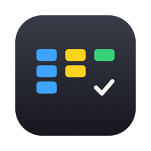
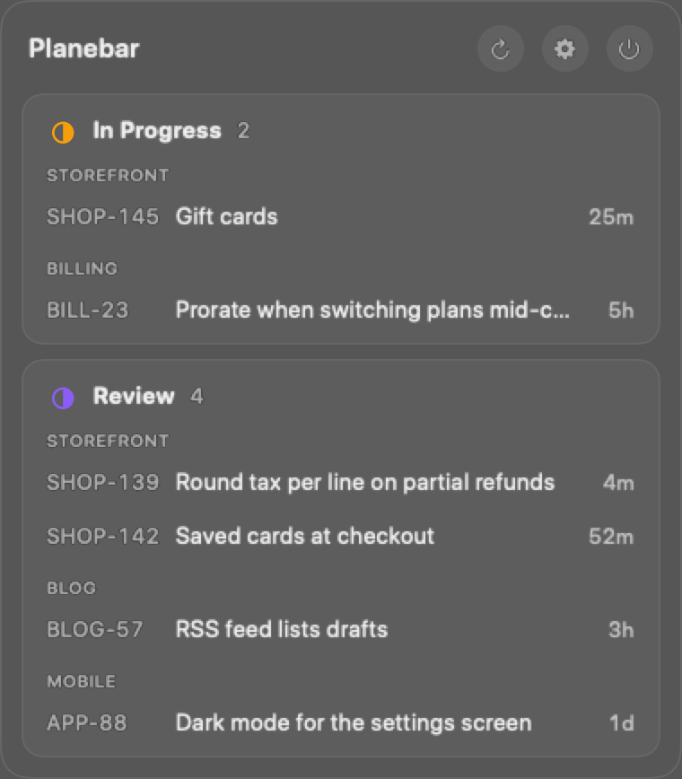
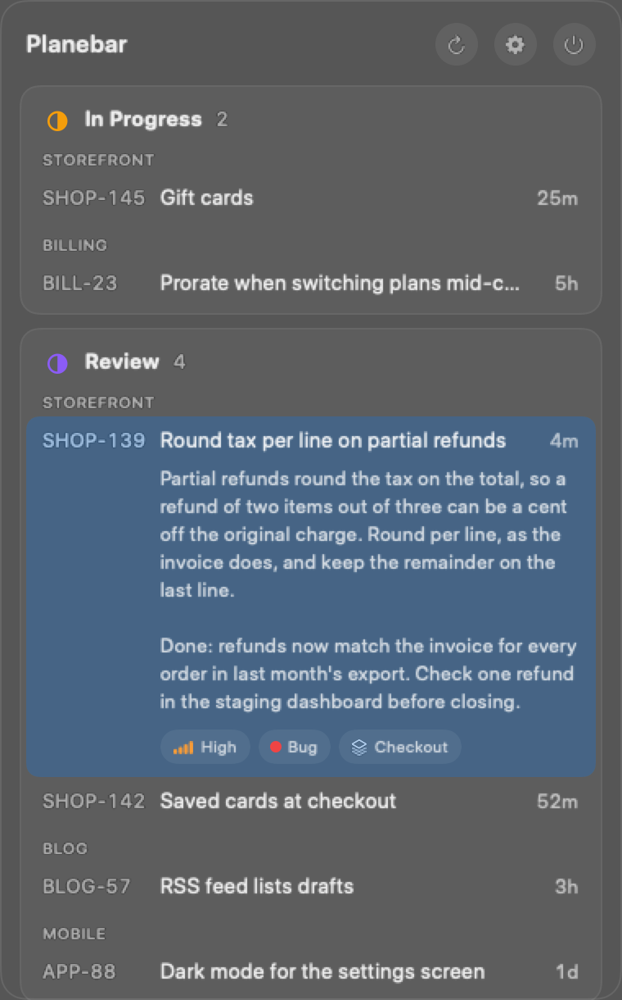
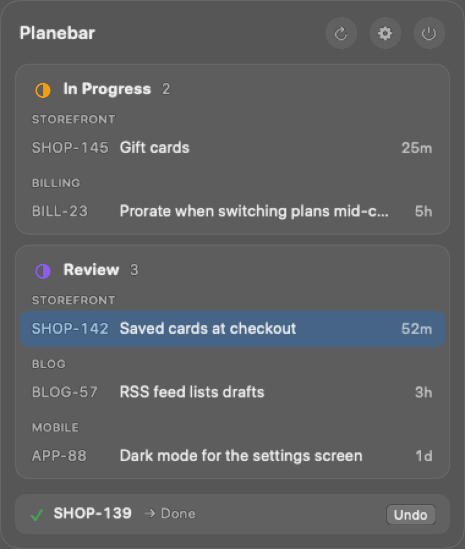
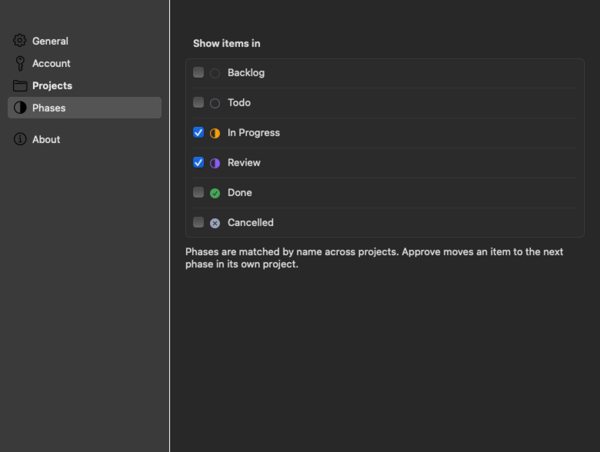

<p align="center">
  
</p>

<h1 align="center">Planebar</h1>

<p align="center">
  Your <a href="https://plane.so">Plane</a> work items in the Mac's menu bar:<br>
  what is waiting in each phase, approved with a click.
</p>

<p align="center">
  
</p>

When work waits in a phase such as Review, Planebar keeps the count in the menu bar,
lists the items without opening the website, and moves each one on when you approve it.

<p align="center">
  
</p>

Version 0.1.2. A personal tool, not affiliated with or endorsed by Plane.

## What it does

| A row opened out | After an approval |
| --- | --- |
|  |  |

- **A count in the menu bar:** the items in the phases you watch. With none, the icon
  stands alone; it dims when there is no key or Plane cannot be reached. While items
  wait, icon and count take a colour you choose in Settings → General.
- **A card per phase,** in the order of Plane's states. Inside a card, items are grouped by
  project when more than one has any, most recently changed first.
- **Details in place:** a click on a row shows the description, priority, labels and module.
- **Approve:** moves the item to the next state in its project's order, never to a
  cancelled one. The row goes at once; Undo puts it back for a few seconds. If Plane
  refuses, the row returns and the reason is shown.
- **Open in Plane:** the item's page in your browser.
- **Notifications:** a banner when an item enters a watched phase. Never for what was
  already there when Planebar started, or for your own approvals.

<p align="center">
  
</p>

The screenshots show invented projects.

## Requirements

- macOS 15 or later.
- A Plane Cloud workspace and a personal API key.
- Xcode, for its Swift toolchain. There is no download; you build it yourself.

## Install

```sh
git clone https://github.com/akiarostami/planebar.git
cd planebar
./scripts/build-app.sh
open ~/Applications/Planebar.app
```

The script builds a release, assembles `~/Applications/Planebar.app` and signs it. Planebar
has no Dock icon; look for the columns icon in the menu bar.

## Setup

1. In Plane, open **Profile settings → Personal access tokens** and create a token.
2. In Planebar, open **Settings → Account**. Enter the workspace, the name in Plane's web
   address (`app.plane.so/<workspace>`), then paste the token and press Save.
3. Under **Projects**, untick any you do not want; under **Phases**, tick the ones to
   watch. Review is ticked to begin with.

The key is kept in the login Keychain as a generic password, service `plane-api`, account
the workspace name. A key added there with `security add-generic-password -s plane-api -a
<workspace> -w` is picked up as well.

## Settings

<p align="center">
  
</p>

| Page | Holds |
| --- | --- |
| General | Launch at login, how often to refresh, notifications, the colour while items wait, and the shortcut. |
| Account | The API key, the workspace, and a connection test. |
| Projects | Which projects to watch. |
| Phases | Which phases to watch: every state name in the chosen projects, matched by name across them. |

## Keyboard

Set a system-wide shortcut under **Settings → General** to open the menu from any app.
With the menu open:

| Key | Action |
| --- | --- |
| ↑ ↓ | Move between items |
| Return or Space | Show or hide the selected item's details |
| → / ← | Show / hide details |
| A | Approve the selected item (change it under Settings → General) |
| ⌘Z | Undo the approval |
| O | Open the selected item in Plane (change it under Settings → General) |
| ⌘R | Refresh |
| ⌘, | Settings |
| ⌘Q | Quit |
| Esc | Close the menu |

## How it works

- Planebar uses Plane's REST API (`api.plane.so/api/v1`) with your key.
- Every refresh is one request: the work items in the watched phases and projects, found
  with a PQL filter. It refreshes every two minutes by default, and when you open the menu
  if the last reading is more than 20 seconds old.
- Projects, states and labels change rarely and are read every half hour, or when the
  choice of projects changes.
- Approve sends one `PATCH` setting the item's state; Undo sends another.
- Plane allows about 60 requests a minute. If it asks Planebar to wait, Planebar waits and
  keeps showing the last reading.

## Privacy

- Planebar talks only to `api.plane.so`.
- It reads the API key from the Keychain and writes only its own settings (macOS defaults,
  `com.minorkey.planebar`).

## Signing

The build script signs with the first code-signing certificate in your Keychain, or the one
named in `PLANEBAR_SIGN_IDENTITY`. With none it signs ad hoc: the app runs, but its
signature changes with every build, so macOS asks again for access to the Keychain item
after a rebuild. A free **Apple Development** certificate, created in Xcode under
Settings → Accounts → Manage Certificates, avoids that.

## Development

```sh
swift test                 # the logic tests
./scripts/build-app.sh     # build, sign and install
./scripts/make-icon.sh     # regenerate Resources/AppIcon.icns after changing the mark
```

| Path | Holds |
| --- | --- |
| `Sources/PlanebarCore/` | Logic with no interface: Plane's API and its data, the next state, PQL, grouping. |
| `Sources/Planebar/` | The app: `AppModel`, the menu panel, banners, settings, shortcuts, the Keychain. |
| `Tests/` | Tests of the logic. |

Environment variables that help when working on it:

- `PLANEBAR_DEMO=1` starts the app with invented projects and the default settings. It
  does not talk to Plane, does not read the Keychain and saves nothing.
- `PLANEBAR_SNAPSHOT_DIR=<folder>` makes the app open its menu and settings pages in turn
  and save a PNG of each. In demo mode it also approves an item and undoes it. The
  screenshots in this README were made with both:

  ```sh
  open --env PLANEBAR_DEMO=1 --env PLANEBAR_SNAPSHOT_DIR=/tmp/shots ~/Applications/Planebar.app
  ```

- `PLANEBAR_API_KEY=<key>` is used instead of the Keychain.

## Limits

- Plane Cloud only; a self-hosted address cannot be set.
- "Changed" is the item's last update, which includes edits as well as moves.
- Phases are matched by name, so projects whose states are named differently need each
  name ticked.

## Licence

MIT. See [LICENSE](LICENSE).
